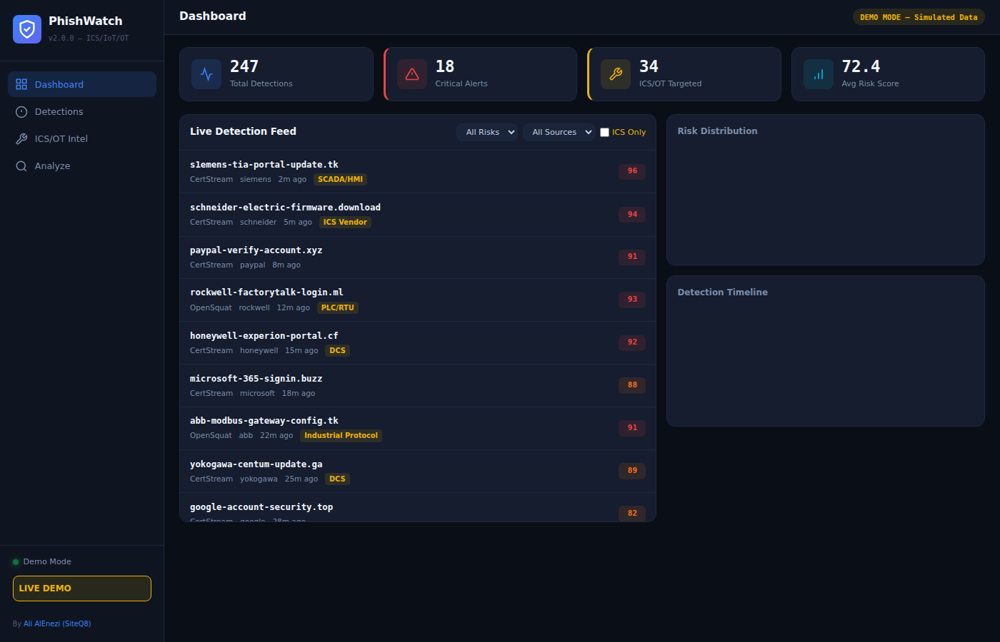

<p align="center">
  
  
  
  
  
</p>

<h1 align="center">🛡️ PhishWatch</h1>
<h3 align="center">ICS / IoT / OT Phishing Detection Platform</h3>

<p align="center">
  Real-time phishing detection with <strong>industrial control system awareness</strong>.<br>
  The first open-source platform purpose-built for detecting phishing campaigns<br>
  targeting SCADA, HMI, PLCs, and OT vendor infrastructure.
</p>

<p align="center">
  <a href="https://siteq8.github.io/PhishWatch/">🔴 Live Demo</a> •
  <a href="#-quick-start">Quick Start</a> •
  <a href="#-icsiotot-detection-engine">ICS/OT Engine</a> •
  <a href="#-api-reference">API Docs</a> •
  <a href="#-contributing">Contributing</a>
</p>

---

## 📸 Screenshots

### Dashboard — Live Detection Feed with ICS/OT Tags



> Real-time detection feed showing phishing domains targeting ICS vendors (Siemens, Schneider Electric, Rockwell, Honeywell, ABB) with color-coded risk scores and ICS category tags.

### Live Monitoring with Toast Alerts


> Live monitoring mode with toast notifications for critical and ICS/OT-targeted threats. Detection stats update in real-time via WebSocket.

---

## ✨ What Makes PhishWatch Different

| Feature | PhishWatch v2 | Generic Phishing Tools |
|---------|:---:|:---:|
| Real-time CertStream monitoring | ✅ | ✅ |
| OpenSquat domain squatting detection | ✅ | ✅ |
| **ICS/IoT/OT vendor impersonation detection** | ✅ | ❌ |
| **30+ ICS vendor keyword matching** | ✅ | ❌ |
| **Industrial protocol detection (Modbus, DNP3, OPC UA...)** | ✅ | ❌ |
| **MITRE ATT&CK for ICS mapping** | ✅ | ❌ |
| **Sector classification (Energy, Oil & Gas, Manufacturing)** | ✅ | ❌ |
| **ICS-aware risk multiplier** | ✅ | ❌ |
| Homograph/IDN attack detection | ✅ | ⚠️ |
| Domain entropy / DGA detection | ✅ | ⚠️ |
| CLI tool + Python package | ✅ | ⚠️ |
| Modern WebSocket dashboard | ✅ | ✅ |
| Docker ready | ✅ | ✅ |

---

## 🚀 Quick Start

### Option 1: pip install

```bash
git clone https://github.com/SiteQ8/PhishWatch.git
cd PhishWatch
pip install -e .
phishwatch serve
```

Open http://localhost:5000 and click **Start Monitoring**.

### Option 2: Docker

```bash
git clone https://github.com/SiteQ8/PhishWatch.git
cd PhishWatch
docker compose up -d
```

### Option 3: Manual

```bash
git clone https://github.com/SiteQ8/PhishWatch.git
cd PhishWatch
pip install -r requirements.txt
python -m phishwatch serve
```

---

## 🏭 ICS/IoT/OT Detection Engine

The core differentiator of PhishWatch is its **ICS/IoT/OT-aware detection engine** — purpose-built to catch phishing campaigns targeting industrial environments.

### Monitored ICS Vendors (30+)

| Vendor | Sector | Products Monitored |
|--------|--------|--------------------|
| **Siemens** | Energy / Manufacturing | WinCC, STEP 7, TIA Portal, S7 PLCs |
| **Schneider Electric** | Energy / Building | EcoStruxure, Modicon, PowerSCADA |
| **Rockwell Automation** | Manufacturing | FactoryTalk, Allen-Bradley, Studio 5000 |
| **Honeywell** | Oil & Gas / Building | Experion PKS, Safety Manager |
| **ABB** | Energy / Utilities | Ability Symphony, AC500 PLCs |
| **Emerson** | Oil & Gas / Chemical | DeltaV, Ovation, AMS |
| **Yokogawa** | Oil & Gas / Chemical | CENTUM VP, ProSafe-RS |
| **GE Digital** | Energy / Utilities | Predix, iFIX, CIMPLICITY |
| **AVEVA / Wonderware** | Manufacturing / SCADA | InTouch, Historian |
| **Mitsubishi Electric** | Manufacturing | MELSEC, iQ-R Series |
| And 20+ more... | | |

### Industrial Protocols Detected

`Modbus` `DNP3` `OPC UA` `BACnet` `PROFINET` `EtherCAT` `EtherNet/IP` `HART` `IEC 61850` `IEC 104` `S7comm` `FINS` `MELSEC` `CIP` `PCCC` `EtherNet/IP`

### MITRE ATT&CK for ICS Mapping

Detections are mapped to [MITRE ATT&CK for ICS](https://attack.mitre.org/matrices/ics/) techniques:

| Technique ID | Name | Trigger |
|---|---|---|
| T0817 | Drive-by Compromise | Vendor impersonation domains |
| T0819 | Exploit Public-Facing App | Portal/login phishing |
| T0862 | Supply Chain Compromise | Firmware/update lures |
| T0865 | Spearphishing Attachment | Email-themed domains |
| T0869 | Standard Application Layer Protocol | Protocol-themed domains |

### ICS Category Classification

Detected domains are classified into categories:

- **SCADA/HMI** — Targeting SCADA software and operator interfaces
- **PLC/RTU** — Targeting programmable logic controllers
- **DCS** — Targeting distributed control systems
- **Safety System** — Targeting safety instrumented systems (SIS)
- **Industrial Protocol** — Protocol-themed lures
- **IoT/IIoT** — Targeting IoT device management
- **Energy/Utilities** — Targeting energy sector infrastructure
- **Building Automation** — Targeting BMS/HVAC systems
- **Supply Chain** — Firmware update and license server lures

---

## 💻 CLI Usage

### Analyze a domain

```bash
# Human-readable output
phishwatch analyze siemens-tia-portal-update.tk

# JSON output
phishwatch analyze schneider-firmware-download.xyz --json
```

**Example output:**
```
============================================================
  PhishWatch Domain Analysis
============================================================
  Domain:       siemens-tia-portal-update.tk
  Risk Score:   96/100
  Threat Level: CRITICAL

  [ICS/OT Context]
  Category:     SCADA/HMI
  Sector:       Energy / Manufacturing
  Vendors:      siemens
  Protocols:    None
  MITRE ICS:    T0817
  Confidence:   50%

  Recommendations:
    • IMMEDIATE: Block domain across all network segments including OT
    • Add to SIEM and firewall deny-lists
    • Alert SOC and OT security teams
    • Investigate brand impersonation — consider takedown
============================================================
```

### Start the dashboard

```bash
phishwatch serve --port 8080 --debug
```

---

## 📡 API Reference

All endpoints are under `/api/v2/`.

| Method | Endpoint | Description |
|--------|----------|-------------|
| `GET` | `/api/v2/status` | Platform status and stats |
| `GET` | `/api/v2/detections` | List detections (filterable) |
| `POST` | `/api/v2/start` | Start monitoring |
| `POST` | `/api/v2/stop` | Stop monitoring |
| `POST` | `/api/v2/analyze` | Analyze a single domain |
| `GET/POST/DELETE` | `/api/v2/keywords` | Manage watchlist keywords |
| `GET` | `/api/v2/export?format=csv` | Export detections (CSV/JSON) |

### Query Parameters for `/api/v2/detections`

| Param | Values | Description |
|-------|--------|-------------|
| `risk` | `all`, `critical`, `high`, `medium`, `low` | Filter by risk level |
| `source` | `all`, `certstream`, `opensquat` | Filter by detection source |
| `ics_only` | `true`, `false` | Show only ICS/OT targeted |
| `limit` | `1-1000` | Max results |

### Analyze a domain via API

```bash
curl -X POST http://localhost:5000/api/v2/analyze \
  -H "Content-Type: application/json" \
  -d '{"domain": "honeywell-experion-portal.cf"}'
```

---

## 🏗️ Architecture

```
PhishWatch/
├── phishwatch/
│   ├── __init__.py              # Package metadata
│   ├── __main__.py              # python -m phishwatch
│   ├── app.py                   # Flask + SocketIO application
│   ├── cli.py                   # CLI entry point
│   ├── config.py                # Configuration (ICS vendors, protocols, etc.)
│   ├── core/
│   │   ├── ics_iot_detector.py  # ★ ICS/IoT/OT detection engine
│   │   ├── domain_analyzer.py   # Domain analysis (similarity, entropy, homograph)
│   │   ├── threat_classifier.py # Multi-factor risk scoring
│   │   ├── certstream_monitor.py# Real-time certificate monitoring
│   │   └── opensquat_integration.py # Domain squatting detection
│   ├── templates/
│   │   └── dashboard.html       # Web dashboard
│   └── static/
│       ├── css/dashboard.css
│       └── js/dashboard.js
├── tests/                       # Test suite
├── docs/index.html              # GitHub Pages demo
├── screenshots/                 # Dashboard screenshots
├── Dockerfile                   # Production container
├── docker-compose.yml
├── pyproject.toml               # Python packaging
├── requirements.txt
└── README.md
```

### Data Flow

```
CertStream (WSS) ──┐
                    ├──▶ Domain Analyzer ──▶ ICS/OT Detector ──▶ Threat Classifier ──▶ Dashboard
OpenSquat (NRD) ───┘     (similarity,        (vendor match,      (9-factor weighted    (WebSocket
                          entropy,             protocol match,     scoring + ICS         real-time
                          homograph)           MITRE mapping)      multiplier)           updates)
```

---

## 🧪 Testing

```bash
pip install -e ".[dev]"
pytest tests/ -v --cov=phishwatch
```

---

## 🐳 Docker Deployment

```bash
# Build and run
docker compose up -d

# Or build manually
docker build -t phishwatch .
docker run -p 5000:5000 -e SECRET_KEY=your-secret phishwatch
```

---

## ⚙️ Configuration

All configuration via environment variables or `.env` file:

| Variable | Default | Description |
|----------|---------|-------------|
| `SECRET_KEY` | `change-me` | Flask secret key |
| `LOG_LEVEL` | `INFO` | Logging level |
| `CERTSTREAM_URL` | `wss://certstream.calidog.io/` | CertStream endpoint |
| `OPENSQUAT_SCAN_INTERVAL` | `1800` | Seconds between OpenSquat scans |
| `MAX_DETECTIONS` | `5000` | Max stored detections |
| `CRITICAL_THRESHOLD` | `90` | Critical risk threshold |
| `HIGH_THRESHOLD` | `70` | High risk threshold |
| `MEDIUM_THRESHOLD` | `50` | Medium risk threshold |

---

## 🗺️ Roadmap

- [ ] STIX/TAXII export for threat intelligence sharing
- [ ] Integration with VirusTotal, URLScan.io
- [ ] Machine learning model for ICS-specific phishing classification
- [ ] Email alerting for critical ICS/OT detections
- [ ] SQLite/PostgreSQL persistence
- [ ] Grafana dashboard integration
- [ ] YARA rule generation from detections
- [ ] Shodan integration for domain infrastructure analysis

---

## 🤝 Contributing

Contributions are welcome! See [CONTRIBUTING.md](CONTRIBUTING.md) for guidelines.

Key areas for contribution:
- Additional ICS vendor keywords and detection patterns
- MITRE ATT&CK for ICS technique mapping
- Dashboard UI improvements
- Integration with threat intelligence feeds
- Documentation and examples

---

## 📝 License

MIT License — see [LICENSE](LICENSE).

---

## 👤 Author

**Ali AlEnezi** ([@SiteQ8](https://github.com/SiteQ8))

---

<p align="center">
  <strong>PhishWatch</strong> — Protecting industrial infrastructure from phishing, one certificate at a time.
</p>
